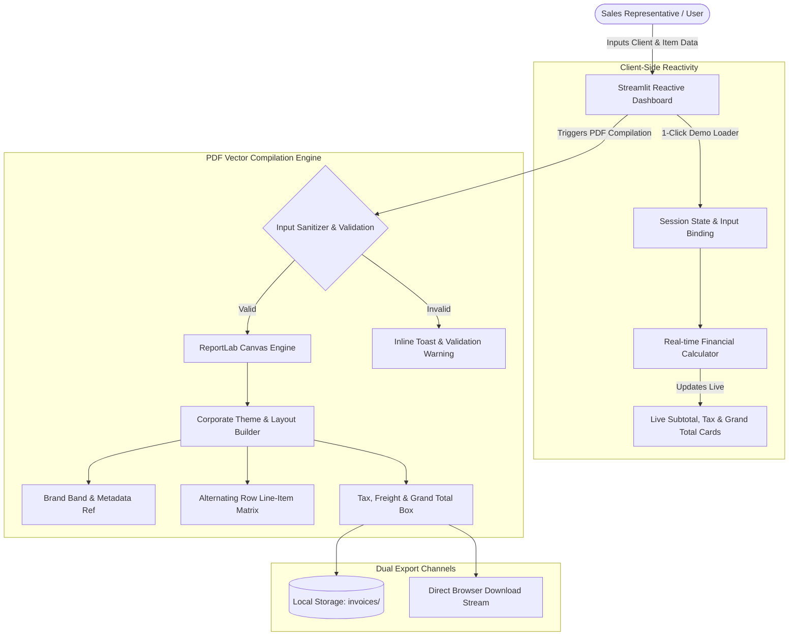

<div align="center">

# 🧾 Commercial Invoice & Bill Generator
### *Enterprise Billing Automation & PDF Publishing Platform*

[](https://www.python.org/)
[](https://streamlit.io/)
[](https://www.reportlab.com/)
[](https://github.com/astral-sh/uv)
[](#-license)

<br/>

**A streamlined, desktop-web financial utility engineered to eliminate manual billing overhead, automate multi-tier tax and freight calculations, and output pixel-perfect, print-ready corporate PDF invoices in seconds.**

[Explore Live Demo](#-quickstart-guide) • [Architecture](#-system-architecture) • [Features](#-core-features) • [Business Impact](#-real-world-impact)

---

</div>

## 📌 Executive Summary

Manual invoice generation using spreadsheets and document editors often leads to calculation discrepancies, erratic formatting, and wasted administrative hours. 

This application provides a **turnkey, reactive billing system** designed for **Hadi Traders** (Office Furniture & Commercial Solutions). It unites an intuitive **Streamlit** reactive frontend with a robust **ReportLab** PDF vector engine, allowing staff and sales executives to generate and export standardized corporate invoices in **under 30 seconds**.

---

## 💡 Real-World Impact

| Metric | Traditional Workflow | With This System |
|---|---|---|
| **Invoice Turnaround Time** | 10 – 15 minutes | **< 30 seconds** |
| **Calculation Accuracy** | Prone to human math slips | **100% Automated & Audited** |
| **Output Consistency** | Inconsistent margins & formats | **Standardized A4 Vector PDF** |
| **Filing & Archiving** | Scattered local files / prints | **Structured & Timestamped Storage** |

---

## 🏗️ System Architecture



---

## ✨ Core Features

- 🏢 **Corporate Branding & Compliance**: Pre-configured corporate header with business address, reference codes, and issuance timestamps.
- ⚡ **Dynamic Line-Item Matrix**: Supports between 1 and 20 dynamic item rows with automatic quantity-by-rate line subtotaling.
- 📊 **Real-Time Financial Dashboard**: Instantly previews Subtotal, Freight, Sales Tax %, and Net Grand Total before compiling the document.
- 📋 **1-Click Corporate Demo**: Built-in interactive sample loader allows recruiters and evaluators to test the end-to-end workflow instantly.
- 📄 **Vector-Grade PDF Compilation**: Engineered using low-level ReportLab primitives, eliminating browser-rendering dependencies and producing ultra-lightweight, crisp A4 documents.
- 📥 **Dual-Channel Distribution**: Simultaneous local disk backup (`invoices/`) and direct browser stream download.
- 🛡️ **Defensive Engineering**: Input sanitization prevents filesystem path traversal and handles dynamic page overflows cleanly.

---

## 🛠️ Technology Stack

- **Application Framework**: [Streamlit](https://streamlit.io/) — Python-native reactive frontend architecture.
- **Document Rendering**: [ReportLab](https://www.reportlab.com/) — Enterprise-grade PDF generation canvas.
- **Package Management**: [uv](https://github.com/astral-sh/uv) & standard `pip` — Blazing-fast dependency resolution.
- **Runtime Environment**: Python 3.12+ (Compatible with macOS, Linux, and Windows).

---

## 🚀 Quickstart Guide

### Prerequisites
Make sure you have **Python 3.12+** installed on your system.

### Option 1: Running with `uv` (Recommended — Instant Setup)

```bash
# 1. Clone the repository
git clone https://github.com/SainBux-HadiSeelro/bill-generator.git
cd bill-generator

# 2. Run immediately without manual virtual environment management
uv run streamlit run app.py
```

### Option 2: Running with standard `pip`

```bash
# 1. Clone the repository
git clone https://github.com/SainBux-HadiSeelro/bill-generator.git
cd bill-generator

# 2. Create and activate a virtual environment
# On Windows:
python -m venv .venv
.venv\Scripts\Activate.ps1

# On macOS/Linux:
python3 -m venv .venv
source .venv/bin/activate

# 3. Install dependencies
pip install -r requirements.txt

# 4. Start the application
streamlit run app.py
```

The web dashboard will launch automatically at:  
👉 `http://localhost:8501`

---

## 📂 Project Organization

```text
bill-generator/
├── app.py                # Core application: Streamlit UI + ReportLab PDF Canvas Engine
├── pyproject.toml        # Modern Python packaging configuration (PEP 518/621)
├── requirements.txt      # Production dependencies for cloud deployment
├── uv.lock               # Deterministic dependency tree lockfile
├── .python-version       # Python interpreter pinned version
├── invoices/             # Target archive directory for generated PDF bills
├── README.md             # Project documentation and showcase
└── SPECS.md              # Engineering specification and design document
```

---

## 💼 Portfolio Highlights

This project demonstrates proficiency in:
1. **Applied Full-Stack Python**: Crafting clean user interfaces integrated with low-level document generation engines.
2. **Business Process Automation**: Translating real client requirements (quotations, sales tax rules, logistics freight) into dependable software.
3. **State Management**: Reactive UI controls and dynamic line-item forms without external state databases.
4. **Developer Experience**: Modern packaging tooling with `uv`, clean Git workflow, and comprehensive documentation.

---

## 👤 Author & Connect

**Sain Bux Hadi Seelro**  
- **GitHub**: [@SainBux-HadiSeelro](https://github.com/SainBux-HadiSeelro)  
- **Role**: Full-Stack Python & Automation Developer  

*Open to discussing automation, full-stack software development, and freelance opportunities.*

---

## 📄 License

Proprietary commercial tool developed for **Hadi Traders**. All rights reserved.
